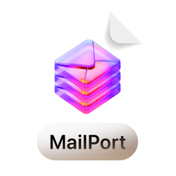

<p align="center">
  
</p>
<h1 align="center">MailPort</h1>
<p align="center"><strong>Set up once. Bring your accounts with you.</strong></p>
<p align="center">An open-source desktop vault and SDK for moving email account settings between compatible apps.</p>
<p align="center">
  <a href="#try-mailport">Try MailPort</a> ·
  <a href="#how-transfers-work">How transfers work</a> ·
  <a href="#build-an-integration">Build an integration</a> ·
  <a href="LICENSE">MIT license</a>
</p>

> [!NOTE]
> MailPort is a developer preview. Try it with the built-in sample accounts.
> The demo receiver supports the transfer flow. Email clients still need to add
> an integration, and independent security review is pending.

## Keep your email setup in one place

**MailPort Vault** keeps your email addresses, credentials, and IMAP/SMTP
settings on your device. Group accounts into profiles, discover server settings
from an email domain, and select the accounts you want to move together.
Password and app-password accounts can transfer their saved credentials.
Google, Microsoft, and other OAuth accounts are prepared for sign-in in the
receiving email app.

**MailPort SDK** gives email-client developers a Node.js/TypeScript reference
implementation. The [open transfer format](docs/transfer.md) lets other
platforms and languages implement the same import flow.

## How transfers work



1. **Start in the receiving app.** Choose **Import from MailPort** to create a
   `.mailportrequest` file.
2. **Export from MailPort Vault.** Select the accounts, click **Export**, then
   **Open import file**. Compare the request codes in both apps. If they match,
   click **Codes match · Save** to create the encrypted `.mailport` file.
3. **Finish in the receiving app.** Open the saved `.mailport` file, compare
   its code with the one shown in MailPort, and import the accounts.

Each export is encrypted for the receiving session, so there's no export
password to type or share. The reference receiver expires a request after
15 minutes, supports retrying an incomplete import in the same session, and
rejects another import after success.

## Try MailPort

Install [Node.js 22+](https://nodejs.org/), stable [Rust](https://www.rust-lang.org/tools/install),
and the [Tauri prerequisites](https://v2.tauri.app/start/prerequisites/) for
your platform.

```sh
git clone https://github.com/mkev07/MailPort.git
cd MailPort
npm ci
npm run vault:dev
```

Create a vault and choose **Try sample accounts**. To exercise an export and
import, run the [demo receiver](docs/transfer.md#try-it-with-synthetic-accounts)
in a second terminal. For platform-specific build instructions, see the
[desktop app guide](apps/vault/README.md#development).

## Security

The local vault uses scrypt and AES-256-GCM. Transfers use HPKE to encrypt
only the selected accounts to the receiving session's public key. The codes
shown in both apps let you verify the request and export. The transfer works
offline between the two apps.

An approved client can keep credentials it imports. To revoke a saved
password or app password, change or revoke it with the email provider. See the
[threat model](docs/security.md) and [security reporting policy](SECURITY.md).

## Build an integration

Start with the [account schema](docs/specification.md#account-model) and
[transfer spec](docs/transfer.md). The SDK provides the request session,
package verification, decryption, and per-account results. Your client
provides the approval UI, secure credential storage, account setup, and
provider sign-in. The package is available in this repository for local
development.

| Start here | What you’ll find |
| --- | --- |
| [Desktop vault](apps/vault/README.md) | Tauri and React app, native builds, and manual checks |
| [Node.js SDK](packages/sdk/README.md) | Reference implementation and local development |
| [Demo receiver](packages/sdk/examples/receive-transfer.ts) | Runnable example using synthetic accounts |
| [Rust vault core](packages/vault-core) | Encryption, validation, and file storage |

```sh
npm run check
npm run check:rust
npm run check:compatibility
```

The compatibility suite checks the Rust sender and Node receiver, including
wrong-recipient handling, retry, expiry, and replay. The next milestone is
to import accounts into a real email client, then verify the same file
protocol with a second independent integration.

See [CONTRIBUTING.md](CONTRIBUTING.md) for how to contribute. MailPort is
licensed under [MIT](LICENSE).
